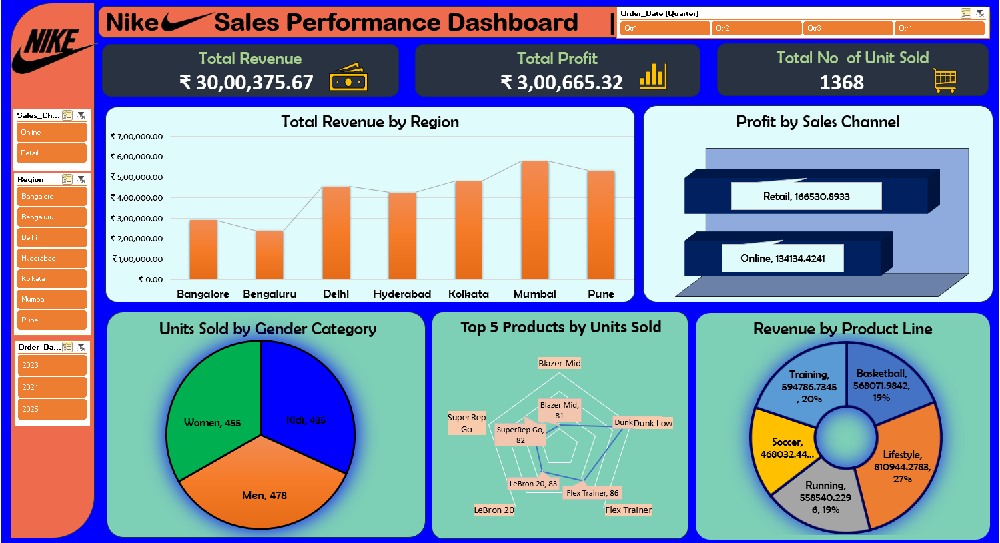

# 👟 Nike Sales Dashboard

An interactive Excel dashboard analyzing **Nike sales data** to uncover key trends, revenue performance, and product insights.
This project showcases **data cleaning, pivot tables, and data visualization techniques** in Excel to create a professional, easy-to-understand dashboard.

## 📸 Dashboard Preview



## 📂 Project Overview

This project visualizes sales trends and business performance for Nike. Key steps:

- **Data Cleaning** – Removing duplicates and handling missing values
- **Pivot Tables** – Aggregating data to summarize sales performance
- **Interactive Charts** – Visualizing sales by region, product, and time
- **Dashboard Design** – Building a user-friendly, interactive dashboard in Excel

## 🚀 Features

- **Dynamic Filters** – Filter by product, region, and time period
- **KPIs & Metrics** – Revenue, quantity sold, and performance indicators
- **Visual Insights** – Charts and graphs for quick decision-making
- **Clean Layout** – Presentation-ready design

## 🛠️ Tech Stack

- **Microsoft Excel** – Data cleaning, pivot tables, slicers, and dashboard design

## 📂 Repository Structure

```
Nike_Sales-_Dashboard/
├── Nike_Sales_Uncleaned.xlsx   # Raw dataset
├── Nike_Dashboard.png          # Screenshot of the dashboard
├── LICENSE
└── README.md
```

## 📖 How to Use

1. Clone the repository:
   ```bash
   git clone https://github.com/Aniketgupta149/Nike_Sales-_Dashboard.git
   ```
2. Open `Nike_Sales_Uncleaned.xlsx` in Microsoft Excel.
3. Use the slicers and filters to explore the data.

## 👨‍💻 Author

**Aniket Gupta**
- 🌐 [Portfolio](https://aniket-portfolio149.web.app/)
- 💼 [LinkedIn](https://www.linkedin.com/in/aniket-gupta-b44611261)
- 🐙 [GitHub](https://github.com/Aniketgupta149)

## 📜 License

This project is licensed under the [MIT License](LICENSE).
